<!-- ====================================================================
  Animated terminal (assets/terminal.svg) -> name -> socials -> about me
  -> stats -> graph -> languages & skills -> commits

  LADYBUG ART: assets/ladybug-about.svg, assets/ladybugs-row.svg and
  assets/ladybug-stats.svg are animated stand-ins (plain ladybug insects).
  To use your own Miraculous Ladybug GIFs, upload them to /assets and
  change the three  lines below.
===================================================================== -->

  

<h1 align="center">🐞 Izalfa 🐞</h1>

  

  
  
  
  
  
  
  
  

---

<h2 align="center">About me</h2>

<table align="center">
<tr>
<td valign="middle">

| | |
|---|---|
| 🦋 **Who I am** | I love building fun side projects and exploring creative ideas |
| 🎨 **Outside tech** | Painting, and always happy to connect with fellow artists |
| 🤝 **Open to** | Collaborating, so hit me up |
| 💻 **Tech** | C++ • JavaScript • TypeScript • React • Next.js • Vue • Node |
| ❤️ **Love to** | Code • Paint • Create |
| 💬 **Motto** | *"Without art, reality is unbearable."* |

</td>
<td align="center" valign="middle">
  
</td>
</tr>
</table>

---

<h2 align="center">📊 GitHub Stats</h2>

<table align="center">
<tr>
<td align="center" valign="top">
   
   
  
</td>
<td align="center" valign="middle">
  
</td>
</tr>
</table>

  

<h3 align="center">🏆 Trophies</h3>

  

<h3 align="center">🔝 Top Contributed Repo</h3>

  

---

<h2 align="center">📈 Contribution Graph</h2>

  

---

<h2 align="center">⚔️ Languages • Frameworks • Tools ⚔️</h2>

  

  

  
  
  

---

<h2 align="center">💾 Commits</h2>

  
  

<!-- productive-time uses UTC by default; add &utcOffset=<your offset> to the URL to match your timezone -->

---

  

Made with ❤️🐞 by <a href="https://github.com/izalfaamjadd">Izalfa</a>

<!-- Proudly created with GPRM ( https://gprm.itsvg.in ) -->
